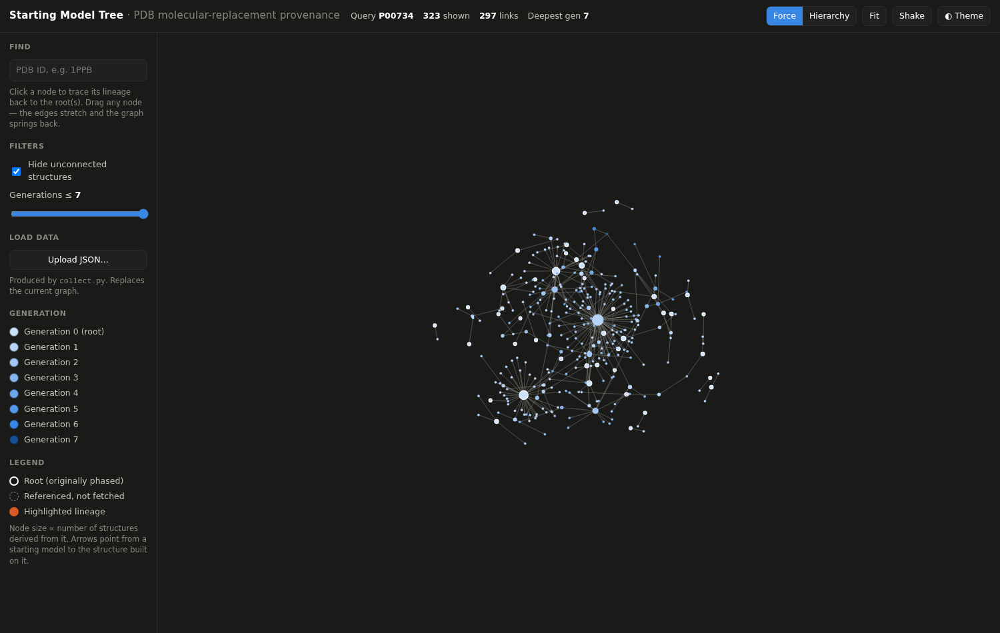
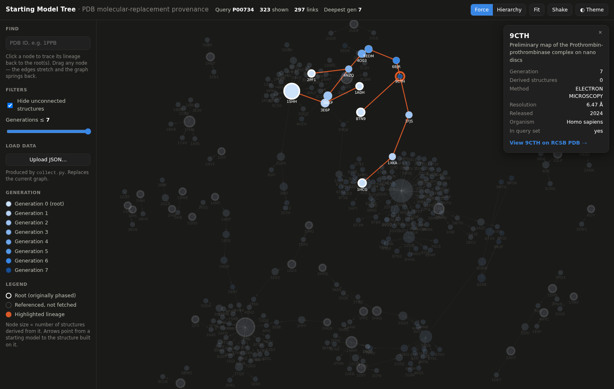

# smtree — Starting Model Tree

Collect molecular-replacement **starting-model provenance** from the RCSB PDB and
render it as an interactive web graph — a "family tree" of structures.

When a structure is solved by molecular replacement (MR), it is built starting
from a previously-solved structure (its *starting model*). The PDB records this in
the mmCIF category `pdbx_initial_refinement_model`. Chaining these relationships
gives a directed acyclic graph back to structures with no recorded starting model
(generation 0). `smtree` collects that graph and lets you explore it in the
browser.

**A missing starting-model record does not mean a structure was originally
phased.** Many MR structures cite their starting model only in free text, which
is not machine-readable. So for every node with no recorded starting model,
`smtree` reads the experimental phasing method (`_refine.pdbx_method_to_determine_struct`)
and labels it as one of:

- **experimentally phased** — a genuine root (SAD, MAD, MIR, …);
- **MR, starting model not recorded** — it *has* a parent, just not in the metadata;
- **provenance not recorded** — no phasing method given, so we can't tell.

In the thrombin demo, of 216 nodes with no recorded parent, only **3** are
confirmed experimental roots; 70 were solved by MR with the parent unrecorded, and
143 are unknown.



*The demo dataset is human thrombin (UniProt P00734): 497 structures, up to 7
generations deep. The live force simulation (WebGL-fast canvas via `force-graph`)
clusters the families and hubs; drag any node and its edges stretch and the graph
springs back.*



*Clicking the deepest structure (`9CTH`, a 2024 cryo-EM map) highlights its full
lineage back through seven generations of starting models.*

## Two parts

```
collect.py  ──►  data/thrombin.json  ──►  build.py  ──►  smtree.html
(RCSB API)       (graph: nodes+edges)     (+ vendor/)     (self-contained page)
```

- **`collect.py`** queries the RCSB Search + Data (GraphQL) APIs, follows every
  structure's starting models upward through ancestry, and writes a graph JSON.
- **`smtree.html`** is a single self-contained page (graph library + dataset
  inlined) that opens in any browser offline. It renders with `force-graph`
  (a live d3-force simulation on canvas), is fully responsive, and can load any
  JSON produced by `collect.py`. It embeds the thrombin dataset by default.

Only the Python standard library is needed to run `collect.py` and `build.py`
(`pytest` is used for the tests only).

## Quick start

The built `smtree.html` is already in the repo — just open it:

```bash
xdg-open smtree.html      # or double-click it
```

To regenerate everything from scratch:

```bash
python collect.py --uniprot P00734 --out data/thrombin.json   # fetch data
python build.py                                               # -> smtree.html
```

## Using the visualization

- **Drag any node** — the live physics simulation stretches its edges and the
  graph springs back into shape.
- **Layout toggle** — *Force* (organic clustering that surfaces hubs; the default)
  or *Hierarchy* (generations stacked top-to-bottom, roots on top). Both are live
  and draggable.
- **Click a node** — highlights its lineage back to the root(s) and opens an info
  panel with method, resolution, release year, organism, and a link to RCSB.
- **Search** — type a PDB ID (e.g. `1PPB`) and press Enter to locate it.
- **Filters** — *Hide unconnected structures* (off by default) and *Generations ≤ N*.
- **Fit / Shake** — recenter the view, or reheat the simulation to re-settle it.
- **Upload JSON** — load a graph for any other protein (see below).
- **Theme** — light/dark toggle; also follows your OS setting.
- **Responsive** — on narrow screens the controls collapse into a drawer (☰).

Node **color** encodes generation; node **size** is proportional to how many
structures were derived from it (hub influence); **arrows** point from a starting
model to the structure built on it.

## Visualizing a different protein

`collect.py` works for any RCSB query, not just thrombin:

```bash
python collect.py --uniprot P00760 --out data/trypsin.json   # by UniProt accession
python collect.py --text "green fluorescent protein" --out data/gfp.json  # full text
python collect.py --query-file myquery.json --out data/custom.json        # raw RCSB query
```

Then either rebuild the page against the new file
(`python build.py --data data/trypsin.json`) or just open `smtree.html` and use
**Upload JSON…** to drop the file in.

> Note: `--uniprot` (the default, `P00734`) gives a precise, biologically coherent
> set. `--text` is broader but noisier — a full-text search for "thrombin" pulls in
> unrelated structures that merely mention the word.

`collect.py` options: `--max-depth` (ancestry-walk rounds, default 8),
`--batch-size` (GraphQL batch size, default 200), `--limit` (cap seeds, for
testing).

## Data schema

`collect.py` emits `{ meta, nodes, edges }`:

```json
{
  "meta": { "query": "P00734", "generated_utc": "…", "source": "RCSB PDB Data API",
            "node_count": 497, "edge_count": 297, "max_generation": 7 },
  "nodes": [
    { "id": "3N99", "title": "…", "method": "X-RAY DIFFRACTION", "resolution": 2.38,
      "year": 2010, "organism": "…", "generation": 2, "is_root": false,
      "in_query": true, "child_count": 0, "sm_type": "experimental model",
      "missing": false }
  ],
  "edges": [ { "source": "3N99", "target": "3DCL", "type": "experimental model" } ]
}
```

`edge.source` is the child structure; `edge.target` is its starting model. Any id
referenced as a starting model is guaranteed to appear in `nodes` (as a
placeholder with `missing: true` if its metadata was not fetched).

## Development

```bash
python -m pytest -q                 # unit tests (no network)
SMTREE_LIVE=1 python -m pytest -q   # also runs the live RCSB integration test
```

Design and implementation notes live in `docs/superpowers/`. Vendored libraries
and their exact versions are recorded in `vendor/SOURCES.md`.
